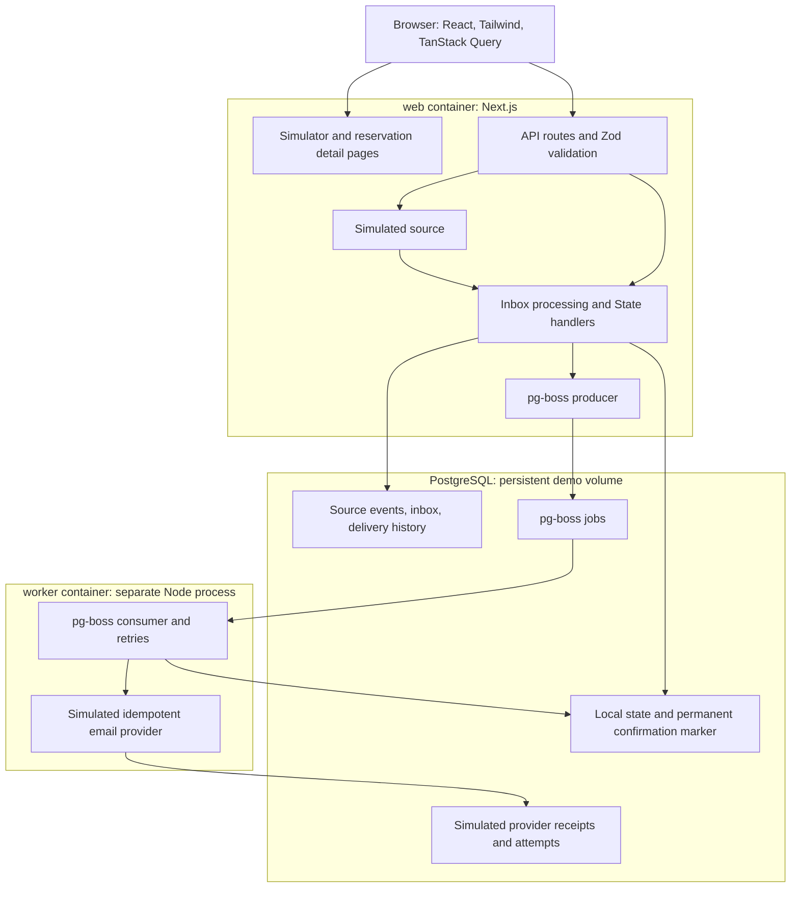

# Architecture

Inbox updates, reservation state, the first-confirmation marker, and job enqueue share one transaction.
The provider receipt is committed separately from worker acknowledgement to model lost responses.
The provider executes within the worker process; its ledger is a simulation of an external boundary.

The one-off `migrate` service applies Drizzle migrations and initializes pg-boss before web/worker
start. pg-boss is a library in both processes, with shared PostgreSQL storage, not another queue server.
The worker runs `tsx src/worker.ts`; Next.js never consumes email jobs.

`/reservations/[id]` validates the ID and existence on the server, then polls the same detail API used
by the simulator. Its three statuses describe reservation lifecycle, synchronization, and email delivery
separately. New email links use `APP_BASE_URL` and are frozen with the confirmation payload.

The `stress` service runs against separate `stress-db`, starts its own worker, and verifies a seeded
concurrent workload. `integration` uses another isolated database, `test-db`. Neither uses demo data.

Authentication is deliberately absent in this localhost demo. A real reservation page and its APIs
must authenticate the visitor and enforce reservation-level authorization before returning any data.
