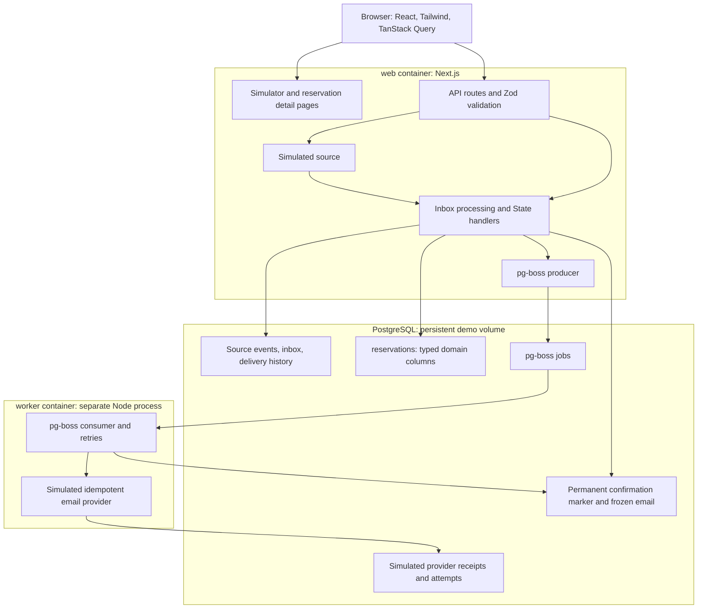

# Architecture

Inbox updates, reservation state, the first-confirmation marker, and job enqueue share one transaction.
The provider receipt is committed separately from worker acknowledgement to model lost responses.
The provider executes within the worker process; its ledger is a simulation of an external boundary.

The one-off `migrate` service applies Drizzle migrations and initializes pg-boss before web/worker
start. pg-boss is a library in both processes, with shared PostgreSQL storage, not another queue server.
The worker runs `tsx src/worker.ts`; Next.js never consumes email jobs.

`/reservations/[id]` validates the ID and existence on the server, then polls the same detail API used
by the simulator. Its three statuses describe reservation lifecycle, synchronization, and email delivery
separately. New email links use `APP_BASE_URL` and are frozen with the confirmation payload.

The `stress` service runs against separate `stress-db`, starts its own worker, and verifies a seeded
concurrent workload. `integration` uses another isolated database, `test-db`. Neither uses demo data.

Authentication is deliberately absent in this localhost demo. A real reservation page and its APIs
must authenticate the visitor and enforce reservation-level authorization before returning any data.

## Domain storage and event tracking

`reservations` is the local domain model. It has typed status, version, guest, property, date, guest
count, and cancellation columns. Date ordering, guest limits, status, and positive version have
database CHECK constraints. Drizzle maps SQL dates to calendar-date strings without timezone shifts.

`streams` holds event-stream identity and simulator metadata; its source JSON represents the fake
external PMS. An inbox event may arrive before creation, so its foreign key targets this tracking
row. There is no incomplete domain reservation until creation is processed. Overview queries use
a left join to keep these waiting streams visible. Detail reads retain repeatable-read consistency.

Raw event payloads and immutable email payloads remain JSONB: those represent received messages,
not the mutable local reservation model. The State pattern still computes transitions in memory;
the sync transaction persists the resulting fields into `reservations` and enqueues any email.

Migration 0001 backfills the old local JSON before dropping `streams.local`. It runs transactionally
through the existing Drizzle migrator. This is a stop-the-app upgrade, not a rolling migration:
the old application requires the removed column and must stop before the migration runs.
